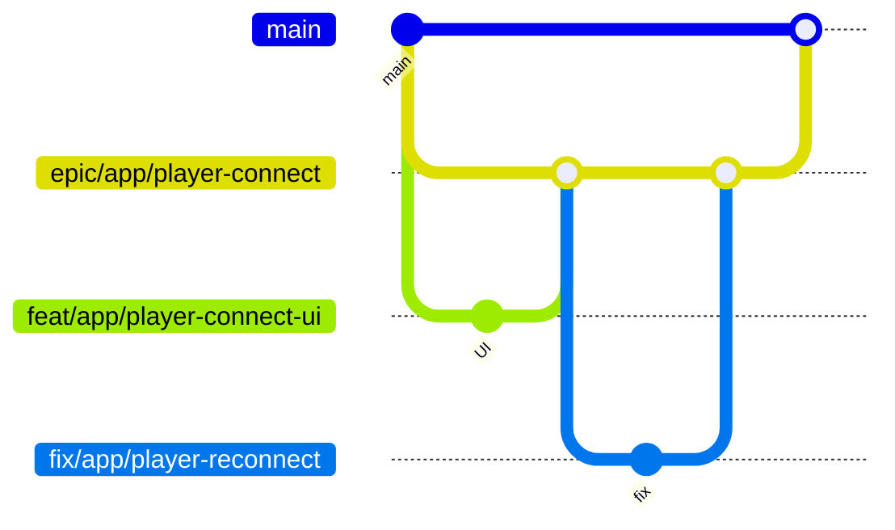

# Ne(o)rdinary Hackathon

11th Ne(o)rdinary Hackathon 모노레포.

| 폴더 | 파트 | 배포 |
|---|---|---|
| [server/](server/) | 백엔드 API (NestJS) | AWS — `main` 푸시 시 GitHub Actions |
| [app/](app/) | 모바일 앱 (Expo / React Native) | — |
| [web/](web/) | 웹 (Next.js) | — |

파트별 실행 방법은 각 폴더의 README를 참고한다.
각 폴더는 독립된 프로젝트다. 의존성 설치와 명령 실행은 해당 폴더 안에서 한다.

```bash
cd server && pnpm install && pnpm start:dev
cd app && pnpm install && pnpm start
cd web && pnpm install && pnpm dev
```

CI/CD 워크플로는 `.github/workflows/`에 있고, `paths` 필터로 해당 폴더가 바뀔 때만 실행된다.

## 린트 / 포맷 (app, web 공통)

모든 파트는 TypeScript를 쓴다. app과 web은 루트의 설정을 공유한다.

- [`.prettierrc`](.prettierrc): 세미콜론 필수, 중괄호 안 공백 없음(`{a}`), 작은따옴표, trailing comma. Prettier는 가까운 설정을 위로 찾아 올라가므로 app/web은 별도 설정 없이 이 파일을 쓴다. server는 자체 `.prettierrc`를 쓴다.
- [`.oxlintrc.json`](.oxlintrc.json): oxlint 공통 규칙. `app/.oxlintrc.json`, `web/.oxlintrc.json`이 `extends`로 가져다 쓰고, 파트별 플러그인(web의 `nextjs` 등)만 덧붙인다.

```bash
pnpm lint    # oxlint + prettier --check (포맷이 어긋나면 실패)
pnpm format  # prettier --write
```

## 폴더 구조 (app, web 공통)

```
src/
├── app/         # 라우트 (Expo Router / Next.js App Router). 화면을 re-export만 한다
├── screens/     # 화면 컴포넌트
├── components/  # 재사용 컴포넌트
├── hooks/
├── constants/
├── utils/
└── api/         # 서버 API 호출
```

- `src/app/`의 파일은 전부 라우트로 잡힌다. 라우트 파일은 `export {default} from '@/screens/home-screen';`처럼 화면만 연결하고, 컴포넌트·훅은 다른 폴더에 둔다.
- 화면 폴더 이름은 `pages`가 아니라 `screens`다. Next.js는 `src/pages/`를 Pages Router 라우트로 인식한다.
- import는 `@/` 별칭을 쓴다 (`@/components/...`).

## 브랜치 전략

서비스별로 에픽 브랜치를 두고, 작업 단위 브랜치는 에픽에서 따서 에픽으로 합친다. 에픽이 끝나면 `main`으로 합친다.



### 이름 규칙

`<타입>/<서비스>/<작업 내용>`. 작업 내용은 소문자 kebab-case로 쓴다.

| 자리 | 값 |
|---|---|
| 타입 | `epic` 서비스별 큰 작업 묶음 · `feat` 기능 · `fix` 버그 수정 · `chore` 설정/의존성/빌드 · `refact` 리팩터링 |
| 서비스 | `app` · `server` · `web` |

예: `epic/app/player-connect`, `feat/app/player-connect-ui`, `fix/server/session-timeout`, `chore/web/oxlint-setup`

### 흐름

1. `main`에서 에픽 브랜치를 딴다: `epic/<서비스>/<작업 내용>`.
2. 작업 브랜치(`feat`/`fix`/`chore`/`refact`)는 해당 에픽에서 따고, PR 대상도 그 에픽이다.
3. 에픽의 작업이 끝나면 에픽 → `main`으로 PR을 올린다.

`main`에 `server/` 변경이 합쳐지면 바로 배포된다(`.github/workflows/deploy.yml`). 서버 에픽은 배포해도 되는 상태일 때 합친다.

