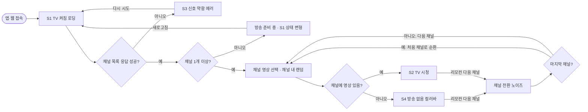

# 03. 화면 구성 · 사용자 플로우 (화면 최적화 20)

> 정보구조도 또는 사용자 플로우 차트 필수 제출 항목
> 디자인: Figma 링크 → ____ (디자이너가 작업 환경 생성 후 기입)
> 화면 수 상한 참고: iOS 전체 뷰 최대 6개 / Tab Bar 최대 2개 영역
> 레이아웃 방침: **모바일 뷰 고정.** 데스크톱에서는 모바일 크기만 중앙에 보이고 양옆은 빈 공간 또는 로고 (반응형 TV 그래픽은 난도가 높아서 하지 않음)

## 사용자 플로우 (Mermaid)
> Figma 도식: 「정보구조도·플로우」 페이지 (영상 확인은 채널을 넘길 때마다 다시 거침)

> 재생 불가(삭제·비공개) 영상은 사용자 조작 없이 같은 채널의 다른 영상으로 자동 교체한다.
> 채널 번호: 첫 채널 = order 1 = 화면 표기 CH 05 (번호는 연출용, 서버는 order 1~7). 예시는 02 편성표 기준(CH 07 · 금융).

## 화면 목록
| 화면 ID | 화면명 | 목적 | 이 화면에서 할 행동 | 다음 단계 | 연결 기능 |
|---|---|---|---|---|---|
| S1 | TV 켜짐 (로딩) | 채널 데이터 로딩 중임을 안내 | 기다림 (스켈레톤 TV 틀) | S2 또는 S3 | F1 |
| S2 | TV 시청 (메인) | TV 화면에서 영상 시청, 리모컨 조작 | 리모컨 "다음 채널" 버튼 누르기 | 같은 화면에서 채널 전환 | F2 F3 F4 |
| S3 | 에러 (신호 약함) | 서버 오류 안내 | "다시 시도" 누르기 | S1 | F1 |
| S4 | 빈 상태 (방송 없음) | 채널에 영상이 없을 때 안내 | 리모컨으로 다음 채널로 넘기기 | S2 | F2 |

> 화면은 **실질적으로 메인 1개 + 상태 화면 3개.** 앱의 스플래시는 가산점용으로 별도 처리 (X4)
> "방송 준비 중"(채널 0개)은 S1의 상태 변형, "영상 로딩 노이즈"는 S2의 상태 변형으로 보고 화면 수에 넣지 않는다.
> S4에서 나가는 경로: 리모컨 "다음 채널" → 다음 채널의 영상 확인 (영상이 있으면 S2, 없으면 다시 S4).

## 메인 화면(S2) 구성 요소
- TV 화면: 유튜브 플레이어가 들어가는 영역 (TV 프레임 안)
- 채널 표시: 현재 채널 번호·이름 (채널 = 카테고리, 예: CH 07 · 금융)
- 리모컨: 큰 "다음 채널" 버튼 1개 (투박한 리모컨 모양)
- 채널 전환 효과: 지지직 노이즈 → 새 채널

## 점검
- [ ] 각 화면에서 해야 할 행동/다음 단계가 명확한가 (S2는 버튼 1개)
- [ ] 불필요한 이동·반복 입력이 없는가 (로그인·검색 없음)
- [ ] 핵심 정보 우선순위, 버튼·메뉴 명확성, 처리 결과 안내가 있는가 (채널 번호 표시, 에러·빈 상태 안내)
